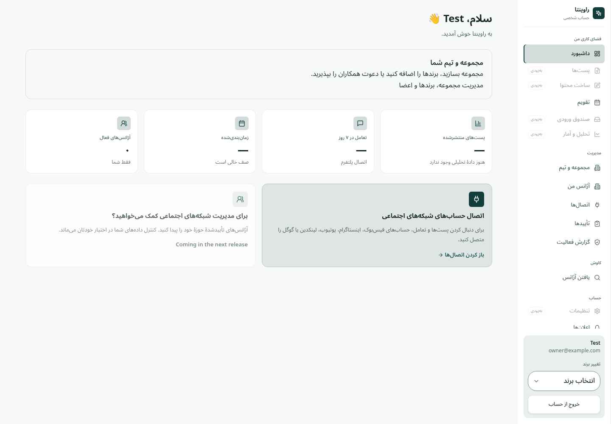
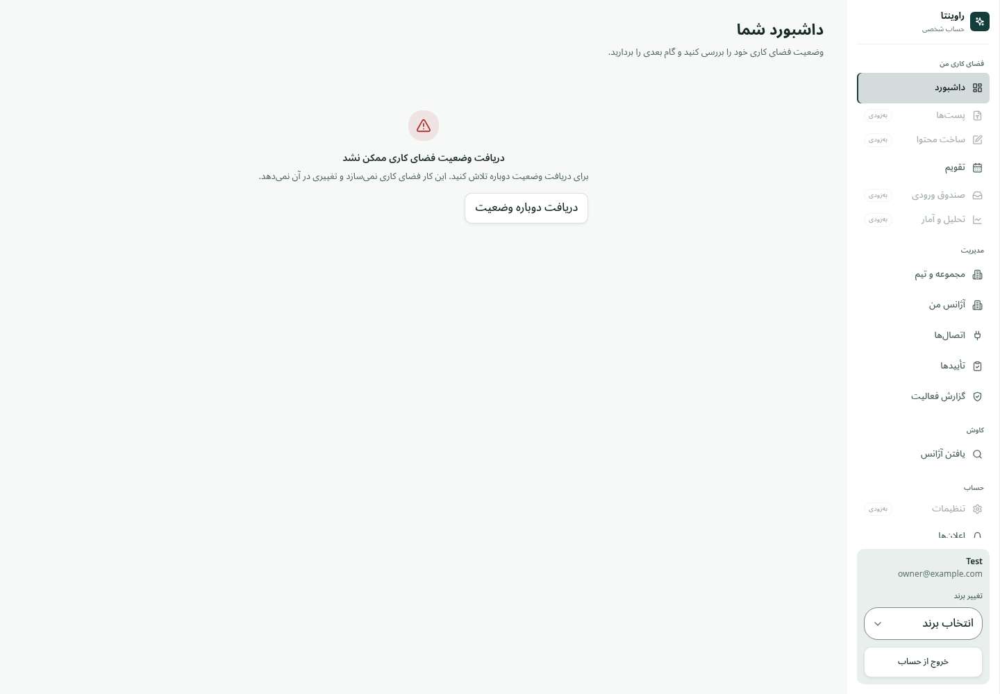
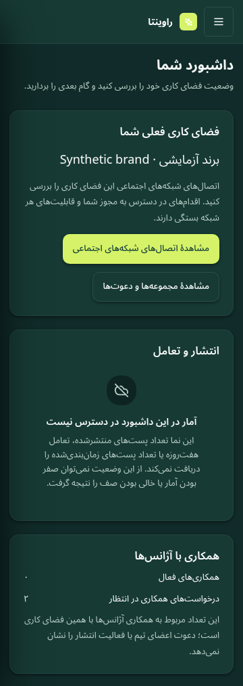

# Dashboard state evidence — plan #214, first delivery

## Scope and provenance

Captured **2026-10-27 UTC** against a locally built Next application. Before:
`41370e109f73d9174ef5a5930f4731c0fae94a30` (current `origin/main` when work began).
After: this PR's source. The only open PR at baseline was #7 (dependency upgrades);
it does not deliver this dashboard change. Root and frontend AGENTS.md, current
#214/#215/#106/#218 and their comments, ACCESS.md and brand rules were reviewed.

**These are fresh browser renders with intercepted, synthetic HTTP responses.**
They are not a live-backend/provider audit, production screenshots, real customer
statistics, or user-research evidence. Screenshots from historical PRs were not used.
The synthetic owner/member identity uses `example.com`; workspace IDs are 10/20,
active agency relationships 0, pending relationships 2. No provider tokens or real
customer data were used. Existing shell text/navigation is outside this change.

Product Design audit guidance was loaded for capture, inspection, evidence labels
and state/next-action review. No interactive Browser/Node REPL tool was exposed in
this session; the repository's Playwright runner and `/usr/bin/chromium` were used
for controlled UI tests. Two referenced shared Product Design guidance resources
were unavailable through the skill reader. Saved product context was absent.
This is a bounded UI verification, not a completed live Product Design audit.

## Steps, health and observations

| Step | Before: directly observed with synthetic responses | After: verified in controlled UI tests | Health |
| --- | --- | --- | --- |
| 1. Open `/u`, summary returns 503 | Welcome, three dashes, “queue empty”, zero agencies; no persistent error or retry | DataState alert and read-only reload button; no empty guidance or private workspace cards | Fixed in this scope |
| 2. Open `/u`, successful `workspace: null` with no current workspace | Same misleading counters and connections CTA as step 1 | Explains organization/workspace creation, invitation acceptance and choosing an already joined workspace; links to `/u/organizations` | Fixed in this scope |
| 3. Open `/u`, successful workspace summary | Three placeholders imply absent analytics, missing connection and empty queue without evidence | Workspace context, scoped connections link, valid relationship counts, explicit unavailable-statistics explanation | Fixed in this scope |
| 4. Retry step 1 using keyboard | No recovery control | Exactly one additional summary GET, no product mutation; success focuses the dashboard heading | Verified after |
| 5. Switch identity/workspace or lose read access | Code had mount-only unscoped state and no cancellation; **not reproduced as a live leak** | Jest deferred reads prove abort/late-answer rejection and immediate hiding; denied refresh clears previous private content; browser checks mismatched workspace summary is hidden | Verified after in tests |

Before screenshots: `before-{error,empty,workspace}-fa-1440.png` (1440 × 1000).
After screenshots: `after-{error,empty,workspace}-{fa,en}-{light,dark}-{360,768,1440}.png`.
All 39 files were captured in this task. The complete after matrix has **36 renders**,
covered by 12 parameterized browser tests; two more browser tests cover recovery
and workspace mismatch. Images were inspected as state contact sheets and selected
full-size views, including Persian dark mobile and English light desktop.
Assertions check dashboard bounds/internal overflow in every matrix cell.

Representative comparison (both controlled responses, not live data):





## Contract and copy decisions

`GET /api/end-user/me/` returns user, default accessible/owned workspace, and, when
there is a workspace, active/pending **agency relationship** counts. It returns no
post/engagement/queue metrics and no connection or publishing capability verdict.
There is no new endpoint. The service accepts an optional AbortSignal; existing
no-argument callers remain valid. Auth, approval rules, aliases and destination
permission checks are unchanged. The CTA opens the existing connections reader;
it does not promise connection/publishing permission or enable a comingSoon route.

A response must match the session identity. A workspace summary must match the
resolved current workspace. A default-summary response cannot be presented as a
summary of a different URL selection; that case explains the limitation and offers
read retry or choosing an accessible default in organizations. Invalid envelopes
are errors, not empty success. Relationship counts are displayed only when both
are nonnegative safe integers. Missing values are never synthesized as zero.

Queries include session/scope/access context, consume cancellation, and discard
inactive snapshots. Recoverable refresh failures keep an already loaded workspace
with a stale warning. 401/403/404 hide its private content. A failed refresh of an
empty response becomes an error rather than quietly retaining empty guidance.

| Semantic key group | Actual state / audience / next step | Owner |
| --- | --- | --- |
| `endDashboard.title`, `description`, `loading`, `refreshing`, `offline` | Private end user; neutral status without inferred activity | Frontend/content |
| `failed`, `denied`, `failedHelp`, `retry` | Read failed or access unconfirmed; reload status only | Frontend/content |
| `empty`, `emptyHelp`, `organizations` | Successful no current workspace; create, review invitation or choose existing access | Frontend/content |
| `workspace`, `workspaceHelp`, `connections` | Matching workspace; open its connections reader | Frontend/content |
| `stats`, `statsUnavailable`, `statsHelp` | No statistics contract; explain exactly which values cannot be inferred | Frontend/content |
| `agencies`, `active`, `pending`, `relationsHelp`, `relationsUnavailable` | Known agency counts vs unknown; distinguish from team invitations | Frontend/content |
| `scopeUnavailable`, `scopeHelp`, `refreshFailed`, `staleHelp` | Scope mismatch or stale read; choose workspace/reload | Frontend/content |

All new copy has fa/en semantic keys in the existing catalog. Workspace names use
`bdi`; counts use `formatNumber`. No public language preference was added.

## Validation and reproduction

Required runtime: Node **20.19.5**, npm **10.8.2**. Initially the environment default
was Node 24/npm 11, so the dependency gate failed as intended; exact versions were
then selected with `npm exec --package=node@20.19.5 --package=npm@10.8.2`.
Final validation uses the required versions:

- Full Jest: **96 suites, 532 tests pass**, including **21 dashboard behavior cases**.
- Production build, TypeScript, i18n parity/inventory, Next independence,
  architecture, lint, API proxy and dependency checks pass (see PR for final results).
- Dashboard browser tests: **14 cases**, including the 36 state/language/theme/width
  renders, scope mismatch and keyboard recovery. No product writes during load/retry.
- Changed-file pre-commit hygiene passes. The gitleaks hook could not build because
  `/usr/bin/go` is not a Go toolchain; the matching official **gitleaks 8.18.4**
  binary ran `protect --staged --redact` separately and found no leaks.
- Existing lint/architecture baselines are retained; untranslated-literal baseline
  has zero increase. Backend tests were not run: no backend code changed.

From `frontend/`, build and start production Next, then run:

```sh
DASHBOARD_CHROMIUM=/usr/bin/chromium \
DASHBOARD_EVIDENCE=e2e/evidence/dashboard-state \
E2E_BASE_URL=http://127.0.0.1:3000 \
npx playwright test e2e/dashboard-state.spec.js --workers=2
```

`DASHBOARD_CHROMIUM` is optional when the runner's bundled Chromium is installed.
The first browser run mistakenly counted an external analytics `/api/send` as a
product write; the harness now distinguishes origins and stubs external requests.
No external analytics event is delivered by the harness.

## Remaining work and evidence limits

- No live Django service, provider credentials or representative-user cohort were
  used. Backend/provider outcome, live role grants and successful invitation or
  connection mutations are not claimed. QA/product owns seeded integrated-role
  checks and the 5–8-user study in #215; an operator must provide the environment.
- Comprehension and task-time improvements remain hypotheses. No percentages,
  task-time improvements or user success rates are invented.
- DataState roles, keyboard activation/focus recovery, reduced-motion test media
  and reflow assertions were checked. Full screen-reader testing, rendered contrast
  audit, 200% browser zoom and WCAG compliance are not claimed; they remain in #215.
- `npm run dev` on the initial environment failed compiling existing instrumentation
  (`node:fs/promises`); the production build/start path succeeded. This PR does not
  change that unrelated setup path. Browser realtime WebSocket attempts cannot reach
  a Django backend here; summaries are explicitly intercepted.
- #106: only dashboard gap delivered; marketplace and the complete gap matrix,
  remaining reader/form/editor/write-recovery families still need acceptance.
- #218: only dashboard title/help/error/empty/status/CTA copy delivered; onboarding,
  menus, demos, AI, public copy, email/metadata and the rest of both waves remain.
- #215: dashboard baseline and controlled comparisons delivered; role matrix across
  all flows, live captures, representative-user tasks and baseline timings remain.
- #214 stays open. None of these issues is closed by this dashboard-only PR.

Rollback: revert this PR; no migrations, schema changes or data writes are involved.
